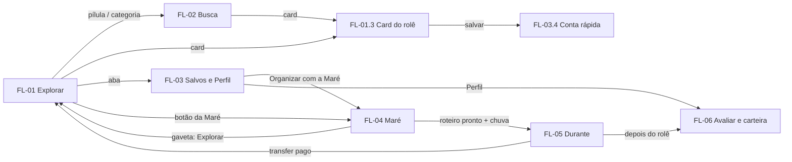

# Fluxos e estados — índice

> **Atualizado:** 2026-11-18 · **Fonte:** levantados no código do protótipo ([`prototype/app/`](../../prototype/app/README.md), branch `feat/agente-conversas`) — descrevem o que **o protótipo faz hoje**, não um fluxo ideal.
> **Relação com o resto dos docs:** a jornada ([jornada.md](../jornada.md)) diz o que a viajante vive (`E-xx`); a tabela de [prototipo.md](../prototipo.md) diz que tela cobre que etapa; aqui fica **o caminho passo a passo** dentro das telas e **os estados** por onde ele passa.

## Convenção de IDs

| ID | O que é | Exemplo |
| --- | --- | --- |
| `FL-xx` | Fluxo: um objetivo dela do começo ao fim, numa área do app | `FL-04` Conversar com a Maré |
| `FL-xx.y` | Subfluxo: um caminho com gatilho e saída próprios, que pode ser reaproveitado por outros fluxos | `FL-04.3` Conversas anteriores |
| `ST-<entidade>` | Estado de uma tela ou de uma coisa do serviço (conversa, conta, transfer…) | `ST-CONVERSA` |
| `ST-<entidade>.<estado>` | Um valor desse estado | `ST-CONVERSA.nova` |

Cada subfluxo traz: **gatilho**, **passos** (ela ↔ app), **saídas** (para onde vai), **estados** que atravessa, **etapa** `E-xx`, personas `P-*`, decisões `D-xx`, questões `Q-xx`, achados `F-xx` (de [UX.md §4](../../UX.md)) e **onde está no código**. O que é inferência vem marcado **(hipótese)**; o que o protótipo só simula (mock, temporizador) vem marcado **(simulado)**.

## Fluxos

| ID | Fluxo | Arquivo | Etapas | Entrada no protótipo |
| --- | --- | --- | --- | --- |
| `FL-01` | Explorar rolês na home | [explorar.md](explorar.md) | `E-01`, `E-03`, `E-04` | `/explorar` (abre por padrão) |
| `FL-02` | Buscar pelo que precisa e filtrar | [busca.md](busca.md) | `E-03`, `E-04`, `E-06` | pílula de busca ou categoria na home |
| `FL-03` | Guardar rolês e cuidar da conta | [salvos-e-perfil.md](salvos-e-perfil.md) | `E-04`, `E-05`, `E-08` | abas Salvos e Perfil |
| `FL-04` | Conversar com a Maré e montar o roteiro | [agente.md](agente.md) | `E-05`, `E-06` | `/agente`, botão da Maré na home |
| `FL-05` | Replanejar e se deslocar durante a viagem | [durante-a-viagem.md](durante-a-viagem.md) | `E-06`, `E-07` | `/agente/chuva` |
| `FL-06` | Avaliar a saída e usar os pontos | [depois.md](depois.md) | `E-08` | `/avaliar`, `/carteira` |

Estados de tela e de entidade: [estados.md](estados.md).

## Mapa geral

## Lacunas que atravessam os fluxos

- **Salvos da home e salvos do agente são listas diferentes no protótipo (simulado).** A pasta de Salvos (`FL-03`) lê o que ela salvou na sessão; o agente (`FL-04`) sempre parte dos 8 rolês do mock. No serviço, deveriam ser a mesma pasta ([Q-37](../questoes-em-aberto.md#q-37)).
- **Histórico de conversas só vive na sessão** e não pede conta ([Q-40](../questoes-em-aberto.md#q-40)).
- **O limite de mensagens não tem tela de "acabou"**: o envio só para de funcionar ([Q-35](../questoes-em-aberto.md#q-35)).
- **O "durante" do rolê** (trajeto, chegada, volta) não tem fluxo próprio além do transfer ([Q-12](../questoes-em-aberto.md#q-12)).
- **Fluxo de quem recomenda** (moradora, criadora) não existe no protótipo ([Q-07](../questoes-em-aberto.md#q-07)).

## Como manter

1. Mudou um caminho no protótipo? Atualize o subfluxo (passos, saídas, estados) e a linha **Atualizado** do arquivo.
2. Caminho novo = subfluxo novo com o próximo número do fluxo; não renumere os existentes (outros docs apontam pelo ID).
3. Estado novo ou valor novo de estado → [estados.md](estados.md), com a transição de entrada e de saída.
4. Se o fluxo depende de algo não decidido, aponte o `Q-xx`; não descreva como decidido.
