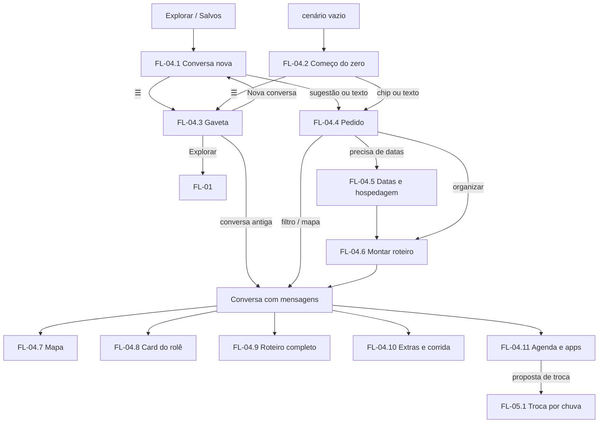

# FL-04 · Conversar com a Maré e montar o roteiro

> **Atualizado:** 2026-11-18 · **Código:** `lib/features/travel_agent/` (`travel_agent_page.dart`, `travel_agent_cubit.dart`, `conversations_cubit.dart`, `agent_sheet.dart`, `conversation_drawer.dart`, `blank_start.dart`, `itinerary_view.dart`, `place_detail.dart`) · **Rota:** `/agente` · Estados: [estados.md](estados.md) (`ST-CONVERSA`, `ST-GAVETA`, `ST-VISAO`, `ST-AGENDA`)

**Objetivo dela:** pedir em linguagem natural ("noite com as amigas", "perto do hotel", "organizar meus rolês") e sair com rolês curados ou um roteiro por dia.
**Etapas:** `E-05` montagem do roteiro, `E-06` ajustes · **Personas:** todas; "Noite com as amigas" → `P-JULIA` · **Decisões:** D-07 (a IA só usa a base curada), D-17 (mensagens limitadas), D-23 (datas e hospedagem antes do roteiro) · **Questões:** [Q-11](../questoes-em-aberto.md#q-11), [Q-35](../questoes-em-aberto.md#q-35), [Q-40](../questoes-em-aberto.md#q-40) · **Achados:** F-08, F-13

As respostas da Maré são **roteirizadas** no mock por palavras do pedido (não há IA real) **(simulado)**.

---

## FL-04.1 · Abrir numa conversa nova

- **Gatilho:** botão da Maré na home (`FL-01.6`), "Organizar com a Maré" em Salvos (`FL-03.3`) ou `/agente`.
- **Passos:**
  1. Conversa em tela cheia, fundo liso, cabeçalho `☰ · Maré · ⋯`.
  2. No centro, a saudação: símbolo da Maré, "Oi, Camila." e uma pergunta sorteada a cada visita ("O que você quer viver em Recife?" e outras).
  3. Acima do composer, três sugestões: "Organizar meus 8 rolês", "Noite com as amigas", "Perto do hotel". Composer: "Pergunte à Maré…".
  4. Sem bloco-resumo azul e sem mapa até ela pedir.
- **Saídas:** `FL-04.3` (☰), `FL-04.4` (pedido), menu ⋯ (`FL-04.7`, `FL-04.11`, `FL-04.12`).
- **Estados:** `ST-CONVERSA.nova`, `ST-VISAO.conversa`, `ST-GAVETA.fechada`.
- **Notas:** a conversa nova parte dos 8 rolês salvos do mock (cenário `padrao`) **(simulado)**.

## FL-04.2 · Começo do zero (nada salvo)

- **Gatilho:** primeira visita, sem rolês salvos (`/agente?cenario=vazio`).
- **Passos:** abre **no mapa**, sem sheet: pontinhos apagados da curadoria, saudação no centro, um chip sorteado e o composer; bichos do mar em pixels nadam pelas bordas. O ☰ fica no lugar do voltar.
- **Saídas:** primeiro envio → o sheet sobe até o meio, o mapa fica aberto e a Maré traz 8 rolês de gente daqui como pins (`FL-04.4`); ☰ → `FL-04.3` (sem conversas antigas: "Nenhuma conversa ainda").
- **Estados:** `ST-CONVERSA.nova`, `ST-VISAO.mapa`.
- **Etapas:** `E-01`, `E-03` · **Decisão:** D-05.

## FL-04.3 · Conversas anteriores (gaveta)

- **Gatilho:** ☰ no cabeçalho da conversa ou no topo do começo do zero.
- **Passos:**
  1. A conversa desliza pra direita (véu escuro por cima) e revela a gaveta: "Maré", "Explorar", **Fixadas**, **Recentes** e o primário "Nova conversa".
  2. Fixada (mock): "Roteiro Recife, 14 a 16 nov". Recentes (mock): "Noite com as amigas", "Perto do hotel", "Organizar meus 8 rolês" (a que falhou).
  3. **Abrir uma conversa:** a gaveta fecha e a conversa aparece como foi deixada; a aberta fica marcada na lista.
  4. **Nova conversa:** volta a `FL-04.1`.
  5. **Explorar:** sai da Maré (volta pra home; se a Maré foi aberta direto pela rota, vai pra `/explorar`).
  6. Fechar: tocar no véu, arrastar a conversa pra esquerda ou o voltar do sistema.
- **Regras ao sair de uma conversa (trocar ou "Nova conversa"):**
  - Se a Maré estava pensando, ela responde na hora antes de guardar.
  - Conversa nova **com** mensagem dela vira a primeira de "Recentes", com a primeira mensagem como título.
  - Conversa nova **sem** mensagem some.
  - Conversa da gaveta guarda onde parou (reabrir mostra as respostas novas).
- **Saídas:** `FL-04.1`, conversa reaberta, `FL-01.1`.
- **Estados:** `ST-GAVETA.fechada` ↔ `ST-GAVETA.aberta`; `ST-CONVERSA` da conversa aberta.
- **Ref.:** ChatGPT (gaveta lateral) · **Questão:** [Q-40](../questoes-em-aberto.md#q-40) (histórico exige conta? quanto tempo guarda?).
- **Lacunas (simulado):** a lista vive só na sessão; não há busca, fixar, renomear nem apagar. As antigas são refeitas a partir do pedido que as abriu.

## FL-04.4 · Fazer um pedido

- **Gatilho:** tocar numa sugestão ou chip, ou enviar texto pelo composer.
- **Passos:**
  1. A mensagem dela entra; a aurora sob o composer se apaga (só existe antes do primeiro envio).
  2. "Pensando" com passos (linha do tempo); dá pra **pular**.
  3. A resposta depende do pedido **(simulado)**:
     - nada salvo ainda → "Separei 8 rolês de gente daqui" + cards (começo do zero);
     - "mapa" → abre o mapa (`FL-04.7`);
     - "comida", "noite"/"amigas", "grátis", "hotel"/"perto" → os salvos daquele recorte, com o motivo, destacados no mapa;
     - qualquer outro, sem roteiro → monta o roteiro (`FL-04.6`), pedindo antes datas e hospedagem se ela ainda não informou (`FL-04.5`);
     - qualquer outro, com roteiro → "Anotado!…" sem mexer no roteiro.
  4. Cada envio conta uma mensagem do limite semanal (o anel ao lado do enviar mostra o uso).
- **Saídas:** `FL-04.5` a `FL-04.8`; volta ao composer.
- **Estados:** `ST-CONVERSA.pensando` → `ST-CONVERSA.respondida` ou `ST-CONVERSA.com-roteiro`.
- **Decisões:** D-07, D-17 · **Questões:** [Q-11](../questoes-em-aberto.md#q-11), [Q-35](../questoes-em-aberto.md#q-35) (no limite o envio para sem aviso **(lacuna)**).

## FL-04.5 · Datas e hospedagem antes do roteiro

- **Gatilho:** pedido que vai virar roteiro sem viagem informada.
- **Passos:** a Maré pergunta "Antes de montar: quando você vai e onde vai ficar?" e mostra um card com chips de datas e de hospedagem; "Montar roteiro" responde. **Não gasta mensagem.**
- **Saídas:** `FL-04.6` com o pedido original.
- **Estados:** `ST-VIAGEM.sem` → `ST-VIAGEM.informada` (vale pro app todo: Salvos e Perfil passam a mostrar as datas).
- **Decisão:** D-23.

## FL-04.6 · Montar o roteiro

- **Gatilho:** "Organizar meus 8 rolês" (ou pedido que não é filtro nem mapa).
- **Passos:** processo longo com visão de agente (cursor recolhe rolês numa pasta e encaixa no calendário Sex/Sáb/Dom) → "Pensou por Xs" → "Pronto! Agrupei seus 8 rolês em 3 dias, por bairro…" + prévia do roteiro (3 primeiras paradas, "Ver no mapa", "Ver roteiro completo") + extras pra sábado + convite pra salvar na agenda. O bloco-resumo azul passa a resumir o fim de semana.
- **Saídas:** `FL-04.7`, `FL-04.9`, `FL-04.10`, `FL-04.11`.
- **Estados:** `ST-CONVERSA.com-roteiro`.
- **Etapa:** `E-05` · **Decisão:** D-07 · **Achado:** F-08 (IA erra rotas, horários e endereços → só dados da base curada).

## FL-04.7 · Ver no mapa e voltar

- **Gatilho:** menu ⋯ → "Ver no mapa", botão "Ver no mapa" (prévia, card do rolê) ou pedir "me mostra no mapa".
- **Passos:** a conversa desce até o meio da tela e revela o mapa desenhado de Recife com pins (roteiro numerado e rota, se houver). O sheet tem três alturas (baixa, média, alta); tocar num pin destaca a parada.
- **Saídas:** voltar (vidro, no topo) ou arrastar o sheet até o topo → conversa em tela cheia.
- **Estados:** `ST-VISAO.conversa` ↔ `ST-VISAO.mapa`.

## FL-04.8 · Card do rolê e vídeos

- **Gatilho:** tocar num card de rolê, numa parada ou num pin.
- **Passos:** o detalhe abre dentro do sheet (alto, no mapa): quem indicou, fotos, vídeos curtos (player com fila), entorno e selo. CTA: "Ver no mapa" e, se ainda não está no roteiro, "Adicionar ao roteiro".
- **Saídas:** voltar à conversa (ou ao roteiro).
- **Estados:** `ST-VISAO.rolê`.
- **Ver também:** `FL-01.3` (mesmo detalhe, na home).

## FL-04.9 · Roteiro completo

- **Gatilho:** "Ver roteiro completo" ou menu ⋯ → "Ver roteiro".
- **Passos:**
  1. Semana: grade 9h–24h com os rolês na cor do tipo; pinça ou ctrl+rolagem dá zoom.
  2. Tocar num dia → guia do dia em cards (hora, nome, dica, melhor horário, vídeos; trajeto entre eles). Troca de dia pelo segmented ou arrastando.
  3. "Editar" → cada card ganha "−" e sai ao remover; "Concluir" fecha a edição.
  4. "Pedir ajuste" abre o composer já focado (`FL-04.4`).
- **Saídas:** voltar (dia → semana → conversa).
- **Estados:** `ST-VISAO.roteiro-semana` → `ST-VISAO.roteiro-dia` ↔ `ST-VISAO.roteiro-editando`.
- **Personas:** `P-MARINA` (lista pronta), `P-CAMILA` (autonomia).

## FL-04.10 · Extras e escolha da corrida

- **Gatilho:** carrossel "Extras pra sábado" na resposta do roteiro.
- **Passos:** "+" adiciona o extra. No transfer, o "+" abre "Escolha a corrida" (categorias da 99 e da Uber por preço, a mais em conta pré-selecionada) e só então adiciona; o card passa a mostrar horário, categoria e preço. Check remove.
- **Saídas:** volta à conversa.
- **Decisões:** D-01, D-17 · **Questões:** [Q-02](../questoes-em-aberto.md#q-02), [Q-03](../questoes-em-aberto.md#q-03), [Q-05](../questoes-em-aberto.md#q-05) — preços e corridas são de mock **(simulado)**.

## FL-04.11 · Conectar agenda e apps

- **Gatilho:** convite da resposta do roteiro ou menu ⋯ → "Conectar agenda".
- **Passos:** sheet escuro de conectores: Google Agenda pelo primário; Google Maps, Uber e 99 com "Conectar" na própria linha (girando → check). Agenda conectada → o convite vira confirmação.
- **Saídas:** volta à conversa. **Com roteiro e agenda conectada, alguns segundos depois a Maré propõe uma troca por chuva** (`FL-05.1`).
- **Estados:** `ST-AGENDA` e `ST-CONECTOR` (desconectado → verificando → conectado).
- **Questão:** [Q-25](../questoes-em-aberto.md#q-25) — integrações **(hipótese)**, nenhuma decidida.

## FL-04.12 · Seus limites

- **Gatilho:** menu ⋯ → "Seus limites".
- **Passos:** sheet com "Semanal", "{usadas} de 20 mensagens", barra e "Reinicia segunda, 00h"; no plano grátis, card do Maré+ com "Assinar por R$ 14,90/mês".
- **Saídas:** fechar.
- **Decisão:** D-17 · **Questões:** [Q-02](../questoes-em-aberto.md#q-02), [Q-35](../questoes-em-aberto.md#q-35) — valor e modelo de assinatura são **(hipótese)**.

## FL-04.13 · Erro e tentar de novo

- **Gatilho:** a Maré não consegue responder (`/agente?cenario=erro` ou a conversa "Organizar meus 8 rolês" da gaveta).
- **Passos:** a mensagem dela e o card "Maré fora do ar" com "Não consegui montar o roteiro agora. Seus rolês salvos continuam aqui — tenta de novo em instantes." e o primário "Tentar de novo"; o bloco-resumo diz que a Maré está fora do ar e os rolês continuam salvos. Composer desligado. "Tentar de novo" refaz o pedido.
- **Saídas:** `FL-04.6`.
- **Estados:** `ST-CONVERSA.erro` → `ST-CONVERSA.pensando`.
