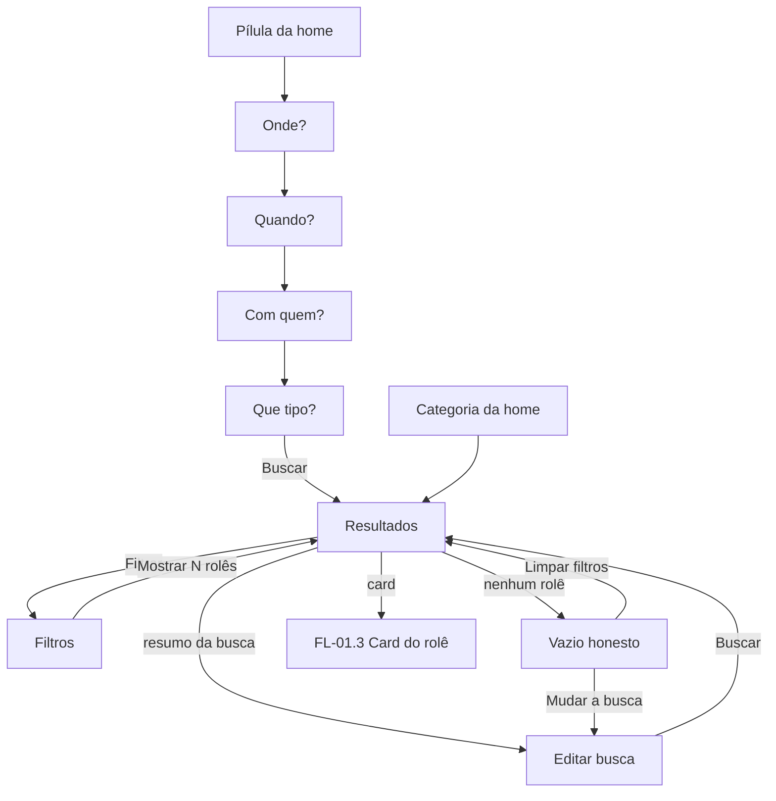

# FL-02 · Buscar pelo que precisa e filtrar

> **Atualizado:** 2026-11-18 · **Código:** `lib/features/explore/` (`search_page.dart`, `search_results_page.dart`, `search_cubit.dart`, `where_picker.dart`, `when_picker.dart`, `filter_pickers.dart`) · Estados: [estados.md](estados.md)

**Objetivo dela:** dizer onde, quando, com quem e o que quer, e ver uma lista curta só da base curada.
**Etapas:** `E-03`, `E-04`, `E-06` · **Personas:** `P-CAMILA` (sozinha), `P-JULIA` (amiga), `P-MARINA` (parceiro(a)) · **Decisões:** D-25 (busca guiada, filtros depois), D-07 (só base curada), D-11 · **Achados:** F-05, F-06, F-13

---

## FL-02.1 · Começar a busca

- **Gatilho:** tocar na pílula "Inicie sua pesquisa" (ou "Pesquisar", compacta).
- **Passos:** a pílula voa até o card "Onde?" em tela cheia. A busca começa do zero, com a companhia já preenchida pelo perfil ("sozinha" no mock), editável.
- **Saídas:** `FL-02.2`; fechar (X) volta à home.
- **Estados:** `ST-BUSCA.passo = onde`.
- **Notas:** a companhia nunca é presumida sem ela ver: vem do perfil e aparece no card "Com quem?" (UX.md §2).

## FL-02.2 · Responder a sanfona (Onde, Quando, Com quem, Que tipo)

- **Gatilho:** `FL-02.1` ou editar a busca (`FL-02.5`).
- **Passos:** um card aberto por vez; os outros mostram rótulo e valor numa linha. Escolha única avança sozinha pro próximo card.
  1. **Onde?** Sugestões "Por perto", Recife, Olinda; digitando, aparecem cidades e bairros.
  2. **Quando?** Calendário com intervalo e folga ("Datas exatas", "± 1 dia", "± 2 dias") ou "Flexível" (fim de semana ou semana, num mês).
  3. **Com quem?** Sozinha, com amiga, com parceiro(a).
  4. **Que tipo?** Chips de categoria (mais de um).
  5. "Limpar" zera a busca; o primário "Buscar" fecha a sanfona.
- **Saídas:** `FL-02.3` (ou volta aos resultados, se estava editando).
- **Estados:** `ST-BUSCA.passo` (onde → quando → quem → tipo).
- **Questões:** [Q-22](../questoes-em-aberto.md#q-22) — "com quem" só muda o texto do resultado, não o filtro **(simulado)**.

## FL-02.3 · Ver resultados

- **Gatilho:** "Buscar" (`FL-02.2`) ou tocar numa categoria da home (`FL-01.1`, busca já com o tipo marcado).
- **Passos:**
  1. Topo: voltar, resumo da busca (toque reabre a busca) e filtrar (com contador).
  2. "N rolês" + "Pra ir…" (companhia) e a lista curta em card grande com carrossel de fotos.
  3. Tocar num card abre o detalhe (`FL-01.3`); salvar segue `FL-01.4`.
- **Saídas:** `FL-01.3`, `FL-02.4`, `FL-02.5`, `FL-02.6`; voltar à home.
- **Estados:** `ST-BUSCA.resultados`.
- **Decisões:** D-25, D-07.

## FL-02.4 · Filtrar

- **Gatilho:** botão de filtro nos resultados.
- **Passos:** sheet "Filtros" que aplica ao vivo:
  - "Pra você": coberto, grátis, perto do hotel;
  - período no arco do dia (manhã, tarde, noite; "Qualquer" limpa);
  - preço por pessoa em histograma com faixa;
  - tipos.
  O primário "Mostrar N rolês" fecha; com 0 rolês ele fica desligado. "Limpar" zera filtros e tipos.
- **Saídas:** `FL-02.3`.
- **Estados:** `ST-BUSCA.filtros` (com/sem filtro ativo).
- **Questões:** sem filtro de segurança enquanto [Q-10](../questoes-em-aberto.md#q-10) estiver aberta (D-25).

## FL-02.5 · Editar a busca

- **Gatilho:** tocar no resumo da busca nos resultados, ou "Mudar a busca" no vazio.
- **Passos:** reabre a sanfona com o que ela já tinha escolhido; "Buscar" volta aos resultados atualizados.
- **Saídas:** `FL-02.3`.

## FL-02.6 · Sem resultado (vazio honesto)

- **Gatilho:** busca + filtros sem nenhum rolê curado.
- **Passos:** "Ainda não temos rolês curados assim" + "Só mostramos o que foi indicado por quem é daqui." e um secundário: "Limpar filtros" (se há filtro) ou "Mudar a busca".
- **Saídas:** `FL-02.3` (sem filtros) ou `FL-02.5`.
- **Estados:** `ST-BUSCA.vazio`.
- **Decisão:** D-07 (não completa com conhecimento genérico) · **Questão:** [Q-38](../questoes-em-aberto.md#q-38) (café sem rolê curado aparece vazio de propósito).
