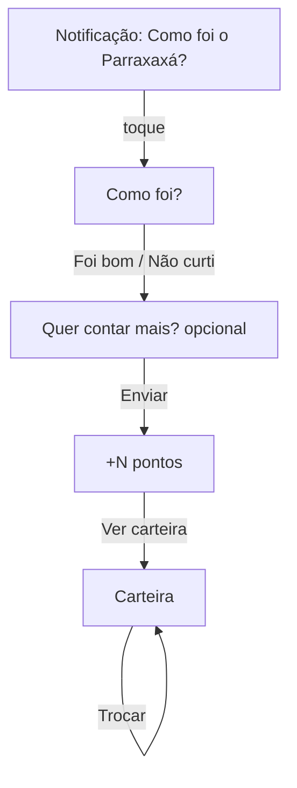

# FL-06 · Avaliar a saída e usar os pontos

> **Atualizado:** 2026-11-18 · **Código:** `lib/features/traveler/` (`rating_moment_page.dart`, `rating_sheet.dart`, `wallet_page.dart`, `traveler_cubit.dart`) · **Rotas:** `/avaliar` (cena 8 da narrativa), `/carteira` · Estados: [estados.md](estados.md) (`ST-AVALIACAO`, `ST-CUPOM`)

**Objetivo dela:** contar em segundos como foi (ajudando outras mulheres) e ver o que ganhou com isso.
**Etapa:** `E-08` · **Decisão:** D-09 · **Questões:** [Q-17](../questoes-em-aberto.md#q-17), [Q-27](../questoes-em-aberto.md#q-27), [Q-30](../questoes-em-aberto.md#q-30) · **Achados:** F-10, F-12

---

## FL-06.1 · Avaliar a saída

- **Gatilho:** de volta ao hotel, notificação "Como foi o {rolê}?" + "Dois toques ajudam outras mulheres a decidir." sobre a home (`/avaliar`).
- **Passos:**
  1. Sheet "Como foi?": o rolê e, se teve, o transfer com a motorista; cada um com "Foi bom" ou "Não curti".
  2. "Quer contar mais?" (opcional): motivos curtos ("Lugar como no vídeo", "Entorno como descrito", "Volta tranquila", "Diferente do descrito").
  3. "Enviar" → "+{N} pontos" (ou "Avaliação enviada" se não respondeu nada) e "Sua avaliação ajuda outras mulheres a decidir."; botão "Ver carteira" (ou "Pronto" quando aberto fora da cena).
  4. Fechar a qualquer momento não bloqueia nada.
- **Regras:** pontos por resposta, nunca pela nota; avaliar de novo a mesma saída não soma.
- **Saídas:** `FL-06.2`; volta à home.
- **Estados:** `ST-AVALIACAO.pendente` → `ST-AVALIACAO.enviada`; `ST-TRANSFER.saida-feita`.
- **Notas:** a visita não é verificada ([Q-30](../questoes-em-aberto.md#q-30)); pontos e regras **(hipótese)** ([Q-27](../questoes-em-aberto.md#q-27)).

## FL-06.2 · Carteira

- **Gatilho:** "Ver carteira" depois de avaliar, `/carteira` ou o fim do Perfil (`FL-03.5`).
- **Passos:** saldo de pontos; "Trocar por" com cupons do próprio serviço ("R$ 5 no próximo transfer", 60 pontos; "10% num rolê em grupo", 100 pontos), cada um com "Trocar" (desligado sem saldo; "Trocado"/"Na carteira" depois); "Histórico" com ganhos e trocas.
- **Saídas:** voltar.
- **Estados:** `ST-CUPOM.sem-saldo` / `ST-CUPOM.disponivel` → `ST-CUPOM.trocado`.
- **Questões:** [Q-27](../questoes-em-aberto.md#q-27) (valor dos pontos), [Q-02](../questoes-em-aberto.md#q-02) — cupons e valores **(hipótese)**.
