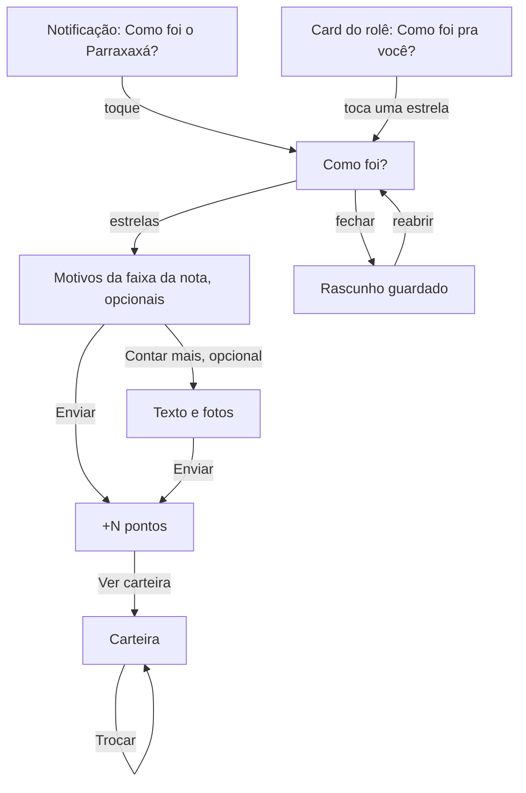

# FL-06 · Avaliar a saída e usar os pontos

> **Atualizado:** 2026-11-23 · **Código:** `lib/features/traveler/` (`rating_moment_page.dart`, `rating_sheet.dart`, `star_rating.dart`, `wallet_page.dart`, `traveler_cubit.dart`), `lib/features/travel_agent/presentation/widgets/role_reviews.dart` · **Rotas:** `/avaliar` (cena 8 da narrativa), `/carteira` · Estados: [estados.md](estados.md) (`ST-AVALIACAO`, `ST-CUPOM`)

**Objetivo dela:** contar em segundos como foi (ajudando outras mulheres) e ver o que ganhou com isso.
**Etapa:** `E-08` · **Decisões:** D-09, D-30 · **Questões:** [Q-17](../questoes-em-aberto.md#q-17), [Q-27](../questoes-em-aberto.md#q-27), [Q-30](../questoes-em-aberto.md#q-30), [Q-41](../questoes-em-aberto.md#q-41) · **Achados:** F-10, F-12

---

## FL-06.1 · Avaliar a saída

- **Gatilho:** de volta ao hotel, notificação "Como foi o {rolê}?" + "Dois toques ajudam outras mulheres a decidir." sobre a home (`/avaliar`).
- **Passos:**
  1. Sheet "Como foi?": o rolê e, se teve, o transfer com a motorista; cada um com **5 estrelas, de meia em meia** (0,5 a 5): tocar na metade esquerda de uma estrela dá meia, do centro pra direita dá a inteira; segurar e arrastar preenche ao vivo, com um tique de vibração a cada meia, e a nota só vale ao soltar. Rótulo ao lado: Não curti, Fraco, Ok, Bom, Muito bom (4,5), Amei.
  2. Depois da estrela do rolê, motivos rápidos **da faixa da nota**, opcionais e com várias escolhas: 4 a 5 "O que você amou?" ("Lugar como no vídeo", "Ok pra ir sozinha", "Volta tranquila"…), 3 "O que podia ser melhor?" ("Mais cheio que no vídeo", "Espera longa"…), 1–2 "O que não rolou?" ("Diferente do descrito", "Não me senti à vontade", "Fechado ou mudou"…). Trocar de faixa tira os motivos que não valem mais.
  3. "Contar mais" (opcional, "+10 pontos" ao lado): campo "O que outra mulher precisa saber?" e até 4 fotos ou vídeos. Sem mídia, o botão da câmera ocupa a largura toda; com mídia, encolhe pra um quadrado fixo à esquerda e as miniaturas ficam lado a lado (vídeo aparece com play, sem quadro — **(simulado)**).
  4. "Enviar" fica ligado desde a primeira estrela → "+{N} pontos" e "Sua avaliação ajuda outras mulheres a decidir."; botão "Ver carteira" (ou "Pronto" quando aberto fora da cena).
  5. Fechar a qualquer momento guarda um **rascunho** e não bloqueia nada.
- **Toques:** estrela + "Enviar" = 2 no caminho rápido (F-10).
- **Regras:** 20 pontos por nota (rolê, transfer), iguais de 1 a 5 estrelas; +10 por contar mais, uma vez por rolê; reenviar troca a avaliação e só paga o que for novo.
- **Saídas:** `FL-06.2`; volta à home.
- **Estados:** `ST-AVALIACAO.pendente` → `rascunho` → `enviada` → `detalhada`; `ST-TRANSFER.saida-feita`.
- **Notas:** a visita não é verificada ([Q-30](../questoes-em-aberto.md#q-30)); pontos e regras **(hipótese)** ([Q-27](../questoes-em-aberto.md#q-27)); texto e fotos publicam sem revisão ([Q-41](../questoes-em-aberto.md#q-41)). As fotos vêm do seletor do aparelho (no web, o de arquivos).

## FL-06.2 · Pontos e cupons

- **Gatilho:** "Ver carteira" depois de avaliar, `/carteira` ou o card "Seus pontos" no Perfil (`FL-03.5`).
- **Passos:**
  1. Página "Pontos" (ref. recompensas do Google Pay): saldo grande, com um "i" ao lado que abre "Como funcionam os pontos" (três páginas com arte: avaliar dá 20 por resposta, juntar, trocar por cupons); "Trocar por" com os cupons em grade — do serviço (R$ 5 no transfer, 10% num rolê em grupo) e de parceiros (99, Uber, drink na Casa Astral). Bloqueado fica cinza com "Faltam N"; trocado ganha o selo "Trocado"; novo, "Novo". "Histórico" embaixo.
  2. Tocar num cupom abre o sheet dele: o cartão, a regra em uma linha, validade e custo.
  3. Disponível → "Trocar por N pontos": o cartão vira e mostra o código; entra o botão segmentado **"Copiar código" | "Abrir na 99"** (ou "Usar no transfer", "Ver rolê"). Copiar vira "Copiado" por um instante.
  4. Bloqueado → botão desligado "Faltam N pontos". Trocado → abre direto no código.
- **Saídas:** voltar; "Abrir na {app}" só avisa que abriria o app **(simulado)**.
- **Estados:** `ST-CUPOM.bloqueado` / `ST-CUPOM.disponivel` → `ST-CUPOM.trocado`.
- **Questões:** [Q-27](../questoes-em-aberto.md#q-27) (valor dos pontos), [Q-28](../questoes-em-aberto.md#q-28) (parceiros), [Q-02](../questoes-em-aberto.md#q-02) — cupons, parceiros, códigos e valores **(hipótese)**.

## FL-06.3 · Avaliar pelo card do rolê

- **Gatilho:** no card do rolê (`FL-01.3`, ou dentro do agente em `FL-04.8`), a seção "Avaliações" tem o card "Como foi pra você?" com 5 estrelas. Qualquer usuária avalia, sempre (D-09).
- **Passos:**
  1. A seção vem depois das fotos. O card "Como foi pra você?" mostra à direita do título a média com estrela e a contagem ("4,3 (4)"), ou "Sem avaliações". Tocar uma estrela abre o sheet "Como foi?" **já com aquela nota** e os motivos da faixa (mesmo sheet de `FL-06.1`, sem o transfer).
  2. Motivos, "Contar mais" e "Enviar" como em `FL-06.1`.
  3. Enviada, as estrelas do card ficam com a nota dela (tocar reabre pra mudar) e a avaliação aparece como **"Você"** logo abaixo; a média e a contagem já contam com ela. Sem texto nem foto, o card dela mostra "Contar mais" (abre o sheet direto no texto e fotos).
  4. Fechou sem enviar: o card mostra as estrelas escolhidas e, na mesma linha, à direita, a pílula neutra "Continuar" (reabre o rascunho como está), sem mudar a altura do card.
- **Lista:** a dela, as 3 mais recentes das outras **por data, nunca por nota** — nome + inicial, com quem foi (sozinha, com uma amiga…), data, estrelas, motivos, texto e fotos (tocar abre em tela cheia). Mais de 3: "Ver todas as N" (o mesmo total do card) abre a lista completa num sheet, com a dela primeiro e o texto inteiro.
- **Vazio:** rolê sem avaliação (ex.: Paço do Frevo, só do Explorar) mostra "Sem avaliações" ao lado do título e as estrelas.
- **Estados:** `ST-AVALIACAO.pendente` → `rascunho` → `enviada` → `detalhada`.
- **Notas:** avaliações das outras viajantes são mock **(simulado)**; sem selo de "visita verificada" ([Q-30](../questoes-em-aberto.md#q-30)).
