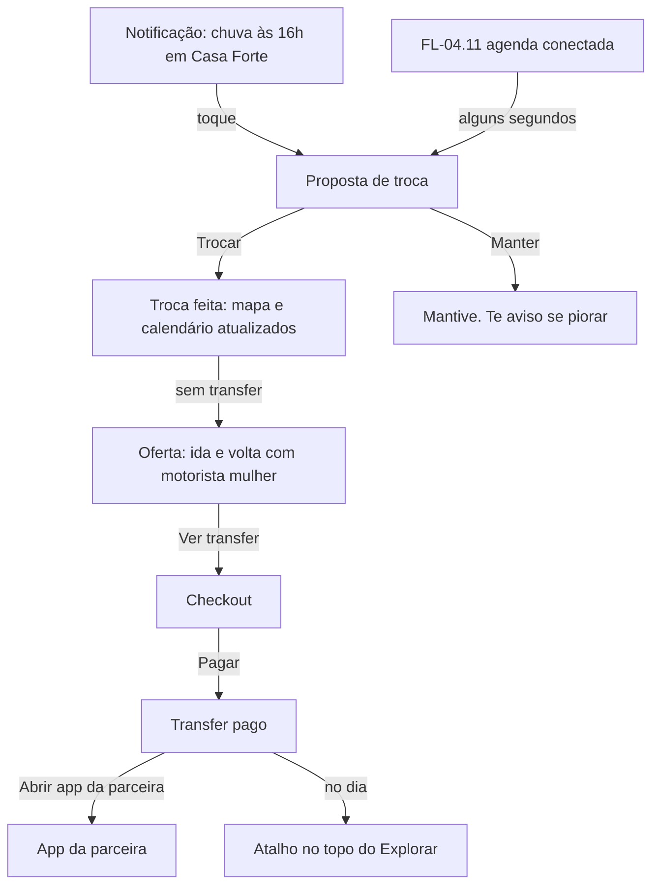

# FL-05 · Replanejar e se deslocar durante a viagem

> **Atualizado:** 2026-11-18 · **Código:** `travel_agent_cubit.dart` (`startRainAlert`, `acceptSwap`, `declineSwap`, `transferBooked`), `agent_sheet.dart` (`_Swap`), `traveler/presentation/widgets/transfer_sheets.dart`, `mare_notification.dart` · **Rota:** `/agente/chuva` (cena 5 da narrativa) · Estados: [estados.md](estados.md) (`ST-TROCA`, `ST-TRANSFER`)

**Objetivo dela:** já em Recife, mudar o plano quando o clima vira e ir e voltar com tranquilidade, sem montar tudo de novo.
**Etapas:** `E-06` ajustes na estadia, `E-07` vivência · **Persona:** `P-CAMILA` · **Decisões:** D-06, D-07, D-26, D-17 · **Questões:** [Q-12](../questoes-em-aberto.md#q-12), [Q-29](../questoes-em-aberto.md#q-29), [Q-39](../questoes-em-aberto.md#q-39), [Q-03](../questoes-em-aberto.md#q-03) · **Achados:** F-03, F-05

---

## FL-05.1 · Troca por chuva

- **Gatilho:** (a) notificação "Chuva às {hora} em Casa Forte" sobre a conversa (`/agente/chuva`), ou (b) roteiro pronto + agenda conectada (`FL-04.11`).
- **Pré-condição:** existe roteiro e ainda não houve proposta.
- **Passos:**
  1. Tocar na notificação abre a conversa (fecha mapa, roteiro e card abertos).
  2. A Maré explica: chuva prevista, o Box Vitória Régia é ao ar livre, propõe o Parraxaxá (coberto, comida pernambucana, mesmo bairro), com o acesso sem pontos de alagamento conhecidos (fonte e data).
  3. Secundário "Manter" em cima, primário "Trocar" embaixo.
     - **Trocar:** "Troquei. Sexta {hora}: Parraxaxá. Mapa e calendário atualizados." O roteiro da sexta troca a parada e o pin fica em foco. Sem transfer pago, entra a oferta (`FL-05.2`).
     - **Manter:** "Mantive o Box Vitória Régia. Te aviso se a previsão piorar."
- **Saídas:** `FL-05.2`, `FL-04.7` (mapa), `FL-04.9` (roteiro).
- **Estados:** `ST-TROCA.nenhuma` → `ST-TROCA.proposta` → `ST-TROCA.aceita` | `ST-TROCA.recusada`.
- **Notas:** previsão, horário e notificação são **(simulado)**; o dado de alagamento é **(hipótese)** ([Q-39](../questoes-em-aberto.md#q-39)). Notificações em geral: [Q-29](../questoes-em-aberto.md#q-29).

## FL-05.2 · Contratar o transfer

- **Gatilho:** oferta "Ida e volta com motorista mulher" depois da troca, ou extra de transfer no roteiro (`FL-04.10`).
- **Passos:**
  1. Oferta opcional com um secundário: "Ver transfer".
  2. Checkout: motorista parceira, horários de ida e volta, preço e cartão; um primário "Pagar {preço}".
  3. Pago → card do transfer na conversa (horário, motorista, preço) com "Abrir app da parceira".
- **Saídas:** app da parceira (fora do serviço); `FL-05.3` no dia.
- **Estados:** `ST-TRANSFER.sem` → `ST-TRANSFER.pago`.
- **Decisão:** D-26 (contrata e paga no app; acompanha no app da parceira) · **Questões:** [Q-03](../questoes-em-aberto.md#q-03), [Q-02](../questoes-em-aberto.md#q-02) — motorista, preço e cartão são **(simulado)**.
- **Lacuna:** a Maré não acompanha a corrida nem a localização dela ([Q-12](../questoes-em-aberto.md#q-12), D-06).

## FL-05.3 · Atalho do transfer no dia

- **Gatilho:** abrir o Explorar com transfer pago e a saída ainda não feita.
- **Passos:** card "Hoje" com horário, motorista e "Abrir app da parceira" no topo da home.
- **Saídas:** app da parceira; some quando a saída acontece (`FL-06.1`).
- **Estados:** `ST-TRANSFER.pago` (no dia) → `ST-TRANSFER.saida-feita`.
- **Etapa:** `E-07`.
