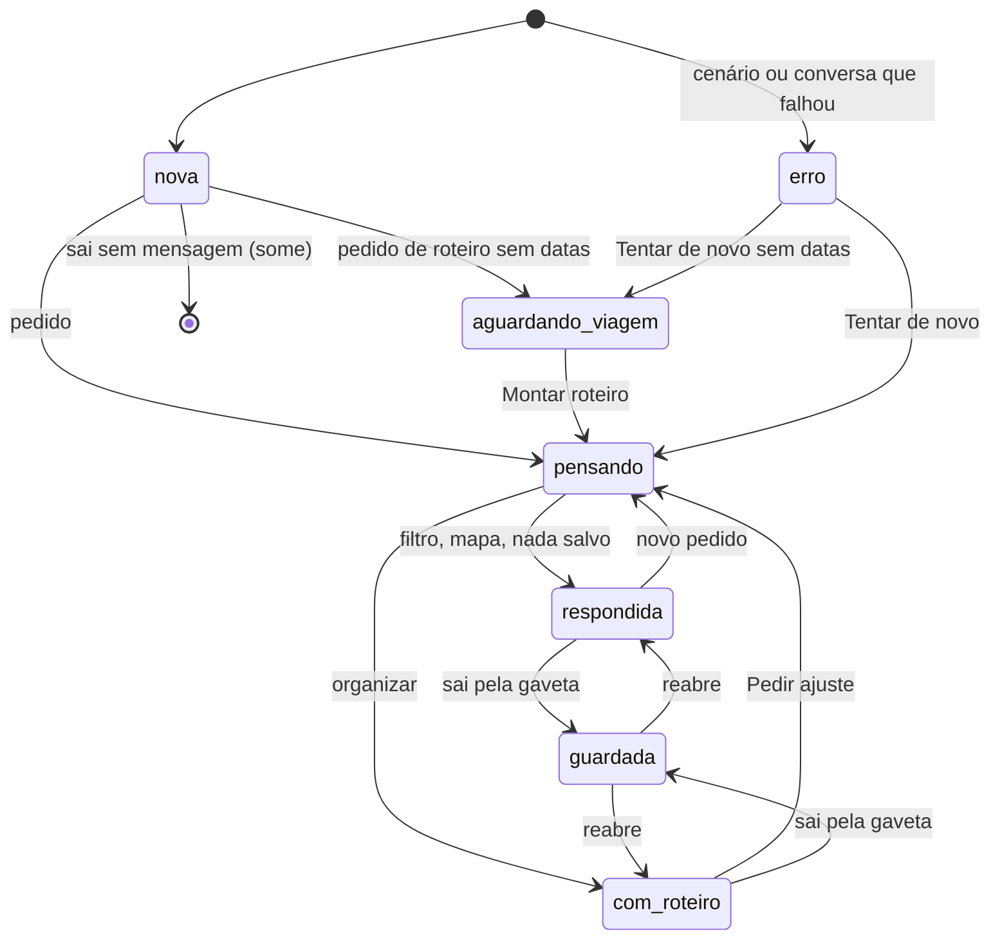

# Estados — telas e entidades

> **Atualizado:** 2026-11-18 · **Fonte:** cubits e mocks do protótipo (`prototype/app/lib/features/*/presentation/view_models/`, `traveler_cubit.dart`). Fluxos que passam por cada estado: [README.md](README.md).

Dois tipos de estado:

- **Estado de tela** (`ST-HOME`, `ST-BUSCA`, `ST-SALVOS`, `ST-VISAO`, `ST-GAVETA`): o que a tela mostra agora. Some quando ela sai da tela.
- **Estado de entidade** (`ST-CONVERSA`, `ST-CONTA`, `ST-VIAGEM`, `ST-TRANSFER`, `ST-TROCA`, `ST-AGENDA`, `ST-CONECTOR`, `ST-AVALIACAO`, `ST-CUPOM`): uma coisa do serviço que atravessa telas. No protótipo vive na sessão (sem backend) **(simulado)**.

Os **cenários** do protótipo (`?cenario=` na URL e rotas da narrativa) são atalhos para abrir uma tela já num estado. A tabela no fim liga cada cenário aos estados.

---

## Estados de tela

### ST-HOME · Explorar

| Estado | O que ela vê | Entra quando | Sai para |
| --- | --- | --- | --- |
| `carregando` | Esqueleto da home | "Tentar de novo"; `?cenario=carregando` | `pronta` |
| `pronta` | Busca, categorias, seções curtas, atalho do transfer no dia | abre o app; dados carregados | — |
| `erro` | "Sem conexão agora" + "Tentar de novo" | falha ao carregar | `carregando` |

Sub-estado `aba`: `explorar` · `salvos` · `perfil` (tab bar ou gaveta da Maré; `?aba=` na URL; cada aba guarda a rolagem). Busca compacta e tab bar recolhida enquanto rola pra baixo. Fluxos: `FL-01`.

### ST-BUSCA · Busca guiada e resultados

| Estado | O que ela vê | Entra quando | Sai para |
| --- | --- | --- | --- |
| `passo` = `onde` · `quando` · `quem` · `tipo` | Um card da sanfona aberto | abrir a busca (começa em `onde`); tocar num card; escolha única avança | `resultados` ("Buscar") |
| `resultados` | "N rolês" + lista curta | "Buscar"; categoria da home; "Mostrar N rolês" | `filtros`, `passo` (editar), `vazio` |
| `filtros` | Sheet que aplica ao vivo, com contagem | botão filtrar | `resultados` |
| `vazio` | Tela de vazio com o motivo, opções pra afrouxar ("Limpar filtros", "Qualquer dia", "Buscar em Recife", só as que trazem rolê) e "Mudar a busca" | nenhum rolê na base curada | `resultados`, `passo` |

Fluxos: `FL-02`.

### ST-SALVOS · Viagens (pastas)

| Estado | O que ela vê | Entra quando | Sai para |
| --- | --- | --- | --- |
| `vazio` | "Nada salvo ainda" + "Explorar rolês" | sem rolês salvos e sem viagem criada | `pastas` |
| `pastas` | Grade de viagens com capa-mosaico + botão + | salvou o primeiro rolê ou criou uma viagem | `vazio`, `pasta` |
| `pasta` | Dias como seções + rolês sem dia + barra "Organizar" / "Organizar com a Maré" | tocou numa viagem (ou num dia) | `organizando`, `pastas` |
| `organizando` | Rolês com check pra escolher, "Concluir" e "Mover pra um dia" | "Organizar" | `pasta` (moveu ou concluiu) |

Fluxos: `FL-03.1`, `FL-03.2`, `FL-03.6`, `FL-03.7`.

### ST-VISAO · O que a tela da Maré mostra

| Estado | O que ela vê | Entra quando | Sai para |
| --- | --- | --- | --- |
| `conversa` | Conversa em tela cheia, cabeçalho `☰ · Maré · ⋯` | abre a Maré (exceto começo do zero); arrastar o sheet ao topo; voltar no mapa | `mapa`, `rolê`, `roteiro-semana` |
| `mapa` | Mapa com sheet na altura baixa, média ou alta | "Ver no mapa"; pedir o mapa; começo do zero | `conversa`, `rolê` |
| `rolê` | Card do rolê dentro do sheet | tocar num card, parada ou pin | estado anterior |
| `roteiro-semana` | Grade da semana 9h–24h | "Ver roteiro completo" / "Ver roteiro" | `roteiro-dia`, `conversa` |
| `roteiro-dia` | Guia do dia em cards, segmented de dias | tocar num dia | `roteiro-semana`, `roteiro-editando` |
| `roteiro-editando` | Cards com "−" e "Concluir" | "Editar" | `roteiro-dia` |

Fluxos: `FL-04.7` a `FL-04.9`.

### ST-GAVETA · Gaveta de conversas

| Estado | O que ela vê | Entra quando | Sai para |
| --- | --- | --- | --- |
| `fechada` | A conversa | abrir a Maré; escolher conversa; "Nova conversa"; tocar no véu; arrastar pra esquerda; voltar do sistema | `aberta` |
| `aberta` | Gaveta à esquerda (Explorar, Salvos, Perfil, Fixadas, Recentes, "Nova conversa"), conversa empurrada com cantos arredondados e véu | ☰ | `fechada`; Explorar, Salvos ou Perfil saem da Maré |

"Recentes" pode estar vazia ("Nenhuma conversa ainda") no começo do zero. Fluxo: `FL-04.3`.

---

## Estados de entidade

### ST-CONVERSA · Uma conversa com a Maré

| Estado | O que ela vê | Regras |
| --- | --- | --- |
| `nova` | Saudação central + 3 sugestões + aurora sob o composer ("Pergunte à Maré…"), sobre o mapa com os bichos do mar em pixels (no começo do zero, o mapa de verdade) | Sem bloco-resumo. Não está na gaveta. |
| `aguardando-viagem` | "Antes de montar: quando você vai e onde vai ficar?" + card de datas e hospedagem | Não gasta mensagem (D-23). |
| `pensando` | Linha do tempo de passos (no roteiro, visão de agente); "Pular" | Composer desligado; cada envio gasta 1 mensagem. |
| `respondida` | Mensagens + rolês filtrados ou mapa | Composer: "Peça um ajuste à Maré…". |
| `com-roteiro` | Prévia do roteiro, extras, convite da agenda; bloco-resumo do fim de semana | Habilita "Ver roteiro", troca por chuva (`ST-TROCA`). |
| `erro` | "Maré fora do ar" + "Tentar de novo"; bloco-resumo de fora do ar | Composer desligado. Só abre pelo cenário ou pela conversa que falhou **(simulado)**. |
| `guardada` | Linha em Fixadas/Recentes da gaveta | Guarda onde parou; se estava `pensando`, responde na hora antes de guardar. Só na sessão ([Q-40](../questoes-em-aberto.md#q-40)). |

Limite de mensagens: a contagem é da semana e segue entre conversas; com 0 restantes o envio é ignorado, sem tela própria — **lacuna** ([Q-35](../questoes-em-aberto.md#q-35)). Fluxos: `FL-04`.

### ST-CONTA · Conta da viajante

| Estado | O que muda | Entra quando |
| --- | --- | --- |
| `sem` | Vê tudo; salvar abre a conta rápida; Perfil mostra "Entrar" | início (D-16) |
| `com` | Salva direto; Perfil mostra viagem e carteira | conta rápida (Apple, e-mail ou Google) |

Não volta pra `sem` no protótipo (não há sair). Fluxos: `FL-01.4`, `FL-03.4`. Questão: [Q-13](../questoes-em-aberto.md#q-13).

### ST-VIAGEM · Datas e hospedagem

| Estado | O que muda | Entra quando |
| --- | --- | --- |
| `sem` | Pasta "Recife, {mês}"; roteiro pede datas antes | início |
| `informada` | Pasta "Recife, {datas}"; Perfil mostra o hotel; roteiro monta direto | card de datas e hospedagem (`FL-04.5`); cenas da narrativa já em Recife |

### ST-TRANSFER · Transfer com motorista parceira

| Estado | O que ela vê | Entra quando | Sai para |
| --- | --- | --- | --- |
| `sem` | Oferta depois da troca; extra no roteiro | início | `pago` |
| `pago` | Card com horário, motorista e "Abrir app da parceira" na conversa; no dia, atalho no topo do Explorar; linha no Perfil | "Pagar {preço}" no checkout | `saida-feita` |
| `saida-feita` | Atalho some; avaliação inclui o transfer | depois do rolê (cena 8) | — |

Decisão: D-26. Fluxos: `FL-05.2`, `FL-05.3`, `FL-06.1`.

### ST-TROCA · Troca por chuva

| Estado | O que ela vê | Entra quando |
| --- | --- | --- |
| `nenhuma` | Roteiro original | início |
| `proposta` | Card da troca com "Manter" e "Trocar" | notificação de chuva; agenda conectada com roteiro |
| `aceita` | "Troquei…", roteiro e mapa com a parada nova; oferta de transfer se não tem | "Trocar" |
| `recusada` | "Mantive… Te aviso se a previsão piorar." | "Manter" |

Só uma proposta por conversa. Fluxo: `FL-05.1`.

### ST-AGENDA e ST-CONECTOR · Google Agenda e apps

`desconectado` → `verificando` (girando) → `conectado` (check). A agenda conectada troca o convite da conversa pela confirmação e, com roteiro, dispara a proposta de troca. Maps, Uber e 99 conectam na própria linha, cada um no seu estado. Fluxo: `FL-04.11`. Integrações **(hipótese)** ([Q-25](../questoes-em-aberto.md#q-25)).

### ST-AVALIACAO · Avaliação da saída

`pendente` (notificação) → `enviada` (pontos somados uma vez por saída). Fechar sem enviar mantém `pendente` e não bloqueia nada. Fluxo: `FL-06.1`.

### ST-CUPOM · Cupom da carteira

`bloqueado` (card cinza, "Faltam N") ↔ `disponivel` (pontos ≥ custo; "Novo" quando é novo) → `trocado` (selo "Trocado"; o sheet mostra o código e "Copiar código" | "usar no app"). Fluxo: `FL-06.2`.

---

## Cenários do protótipo → estados

| Tela | Cenário (URL) | Estados |
| --- | --- | --- |
| Explorar | padrão (`/explorar`) | `ST-HOME.pronta` |
| Explorar | `?cenario=carregando` | `ST-HOME.carregando` (fica no esqueleto) |
| Explorar | `?cenario=erro` | `ST-HOME.erro` |
| Maré | padrão (`/agente`) | `ST-CONVERSA.nova`, `ST-VISAO.conversa`, 8 rolês salvos no mock, gaveta com 1 fixada e 3 recentes |
| Maré | `?cenario=vazio` | `ST-CONVERSA.nova`, `ST-VISAO.mapa` (começo do zero), gaveta sem conversas |
| Maré | `?cenario=carregando` | `ST-CONVERSA.pensando` (em loop) |
| Maré | `?cenario=erro` | `ST-CONVERSA.erro` (é a conversa "Organizar meus 8 rolês" da gaveta) |
| Maré | `/agente/chuva` | conversa fixada "Roteiro Recife" aberta: `ST-CONVERSA.com-roteiro`, `ST-AGENDA.conectado`, `ST-TROCA.nenhuma` + notificação de chuva; `ST-CONTA.com`, `ST-VIAGEM.informada` |
| Avaliar | `/avaliar` | `ST-AVALIACAO.pendente`, `ST-TRANSFER.saida-feita`, `ST-CONTA.com` |
| Carteira | `/carteira` | `ST-CUPOM` conforme os pontos |
