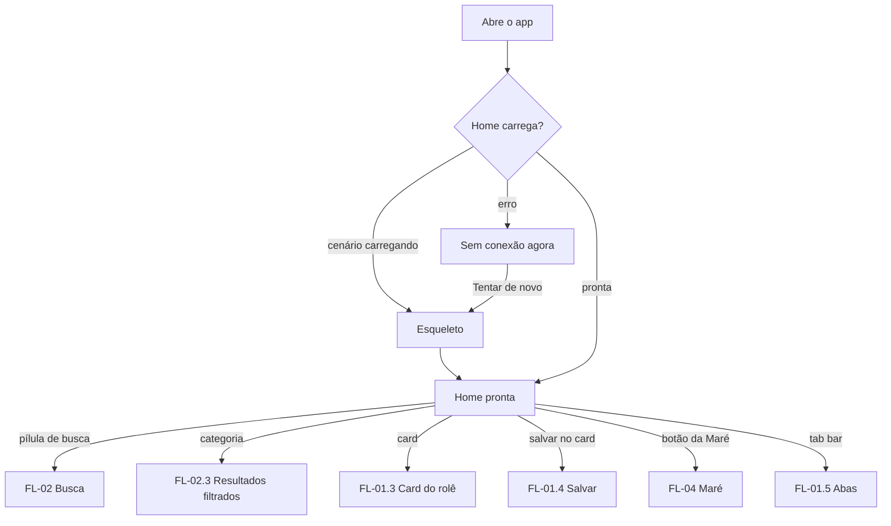

# FL-01 · Explorar rolês na home

> **Atualizado:** 2026-11-18 · **Código:** `lib/features/explore/` (`explore_page.dart`, `role_page.dart`, `explore_cubit.dart`) · **Rota:** `/explorar` (abre por padrão) · Estados: [estados.md](estados.md)

**Objetivo dela:** ver rolês curados de gente daqui, sem feed infinito, e decidir se algum vale (salvar, abrir, pedir ajuda à Maré).
**Etapas:** `E-01` inspiração, `E-03` busca, `E-04` validação · **Decisões:** D-24 (home com tab bar, agente não é aba), D-03, D-16, D-21 · **Achados:** F-01, F-02, F-06, F-13

---

## FL-01.1 · Ver a home

- **Gatilho:** abrir o app (ou sair da Maré pela gaveta → "Explorar", `FL-04.3`).
- **Passos:**
  1. A home abre pronta (`ST-HOME.pronta`). O esqueleto (`ST-HOME.carregando`) só aparece ao tentar de novo depois de um erro ou no cenário `?cenario=carregando` **(simulado)**.
  2. No dia em que ela tem transfer pago, o **atalho do transfer** aparece no topo (`FL-05.3`).
  3. Topo: pílula "Inicie sua pesquisa" e, à direita, o botão da Maré.
  4. "Explore rolês" com as categorias (restaurantes, café, museu, cultura, arte, história) em carrossel.
  5. Seções curtas (até 5 rolês), a da hora primeiro: "Pra esta manhã/tarde" ou "Pra hoje à noite", "Pra ir sozinha" (companhia do perfil), "Mais perto do hotel" (com distância), "Se chover" (só cobertos).
  6. Cada card mostra foto, nome, bairro e preço (ou distância), quem indicou e o motivo.
- **Saídas:** `FL-02.1`, `FL-02.3`, `FL-01.3`, `FL-01.4`, `FL-01.5`, `FL-04.1`.
- **Estados:** `ST-HOME`, `ST-TRANSFER` (atalho).
- **Notas:** seções montadas pela hora do aparelho e pelo perfil do mock (Camila, sozinha, hotel em Boa Viagem) **(simulado)**. Seção da companhia segue o perfil: `P-CAMILA` no mock.

## FL-01.2 · Erro e tentar de novo

- **Gatilho:** a home não carrega (cenário `?cenario=erro`).
- **Passos:** "Sem conexão agora" com o secundário "Tentar de novo" → esqueleto → home pronta.
- **Saídas:** `FL-01.1`.
- **Estados:** `ST-HOME.erro` → `ST-HOME.carregando` → `ST-HOME.pronta`.
- **Notas:** a falha é simulada; a volta leva 0,9 s **(simulado)**. Conectividade instável no destino segue em [Q-25](../questoes-em-aberto.md#q-25).

## FL-01.3 · Abrir o card do rolê

- **Gatilho:** tocar num card da home, dos resultados (`FL-02.3`) ou de Salvos (`FL-03.2`).
- **Passos:**
  1. A foto cresce até a página do rolê ("Rolê de local").
  2. Ela vê quem indicou e por quê, fotos reais (tocar abre em tela cheia), vídeos curtos (tocar abre o player), o que fazer, melhor horário, quanto custa, selo e entorno com data.
  3. Salvar fica no cabeçalho (`FL-01.4`).
- **Saídas:** voltar à tela de origem; player de vídeos e volta.
- **Etapa:** `E-04` · **Decisões:** D-03, D-05, D-06, D-18 · **Questões:** [Q-08](../questoes-em-aberto.md#q-08), [Q-10](../questoes-em-aberto.md#q-10) (selo), [Q-34](../questoes-em-aberto.md#q-34) (vídeos).
- **Notas:** é o mesmo detalhe que o agente abre dentro do sheet (`FL-04.8`).

## FL-01.4 · Salvar um rolê (pede conta)

- **Gatilho:** tocar em salvar no card da home, no detalhe ou em Salvos.
- **Passos:**
  1. **Sem conta:** abre a conta rápida (Apple, e-mail ou Google, um passo, sem verificação).
     - Fechou sem escolher → nada é salvo.
     - Escolheu → a conta é criada e o rolê já fica salvo.
  2. **Com conta:** salva ou tira dos salvos direto.
  3. Aviso curto: "Salvo em {pasta da viagem}" ou "Tirado dos salvos".
- **Saídas:** volta à mesma tela; o rolê aparece em Salvos (`FL-03.2`).
- **Estados:** `ST-CONTA.sem` → `ST-CONTA.com`; rolê salvo/não salvo.
- **Etapa:** `E-04` · **Decisões:** D-16 (ver sem login, conta para salvar), D-23 · **Questões:** [Q-13](../questoes-em-aberto.md#q-13), [Q-37](../questoes-em-aberto.md#q-37) · **Achado:** F-11.
- **Código:** `traveler/presentation/widgets/account_sheet.dart` (`saveRole`).

## FL-01.5 · Trocar de aba

- **Gatilho:** tocar ou arrastar a tab bar (Explorar, Salvos, Perfil).
- **Passos:** a aba troca em fade; cada aba guarda a própria rolagem. Rolando a home pra baixo, a busca compacta e a tab bar sai da tela; rolando pra cima, voltam.
- **Saídas:** `FL-03.1` a `FL-03.5`.
- **Estados:** `ST-HOME.aba` (explorar, salvos, perfil).
- **Notas:** tab bar é **(hipótese)** de app ([Q-25](../questoes-em-aberto.md#q-25)).

## FL-01.6 · Chamar a Maré

- **Gatilho:** botão da Maré no topo da home.
- **Passos:** a Maré entra da direita (push do iOS) por cima da home, numa conversa nova (`FL-04.1`).
- **Saídas:** `FL-04`; volta pela gaveta → "Explorar", "Salvos" ou "Perfil" (`FL-04.3`), que abre a home já na aba tocada.
- **Decisão:** D-24 (o agente não é aba).
